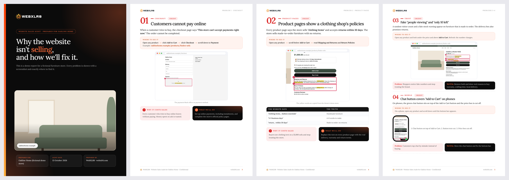

# Website Sales Audit: an agent skill

Give Claude a website URL. You get back a **client-ready PDF audit** that shows every problem costing the site sales. Each problem has an annotated screenshot, the exact clicks to see it, why it matters and what you'll do about it. The report carries **your agency's branding** and **the client's font and logo**.



*Pages from the [sample report](examples/demo/sample-report.pdf) for a fictional store, built with the [WebXLR8](https://webxlr8.com) agency config.*

## What it does

1. **Reads the client's brand**: platform (Shopify, WooCommerce and others), fonts, colours, logo, and the product catalogue on Shopify.
2. **Crawls every page** on desktop (1440px) and mobile (iPhone), with screenshots and automatic checks: 404s, broken images, horizontal scroll, theme placeholder text, missing headings.
3. **Tests the buying journey**: menus, search, quick view, wishlist, cart, and checkout *up to the payment step*. It never enters details or places an order.
4. **Verifies every finding** at full resolution before reporting it, so you don't show a prospect a false claim.
5. **Captures evidence** with numbered red boxes and the exact words highlighted.
6. **Writes in plain language** for business owners: "Where to see it", "Why it costs sales", "What we'll do".
7. **Builds the PDF**: cover, one-page summary, one page per urgent problem, two per page for the rest, a growth ideas page, a 30-day plan, a "Why us" page and a contact back cover. It also checks for overflow and missing fonts.

Typical findings: checkout that can't take payments, theme demo text left on product pages ("clothing items", "$150"), fake "people viewing" counters, chat buttons covering *Add to Cart* on phones, broken wishlist or blog pages, delivery times that contradict each other across pages, and typos.

## Install

**Claude Code**
```bash
git clone https://github.com/webxlr8/website-sales-audit ~/.claude/skills/website-sales-audit
pip install playwright pillow pypdfium2
python3 -m playwright install chromium   # skip if Google Chrome is installed
```

**Claude.ai / Claude desktop**: download the repo as a ZIP and upload it under *Settings → Capabilities → Skills*. You'll need code execution enabled.

Other agents that support the `SKILL.md` format can load the folder the same way.

## Set up your agency branding (once)

```bash
mkdir -p ~/.config/website-sales-audit
cp ~/.claude/skills/website-sales-audit/assets/agency.example.json ~/.config/website-sales-audit/agency.json
```

Edit it with your name, website, email, phone, city, accent colour, logos (one for light and one for dark backgrounds), stats and optional client logos. Paths are relative to the config file. [`examples/agency-webxlr8/`](examples/agency-webxlr8/) is a complete real example. If you skip this step, Claude will ask for the details the first time you run an audit.

## Use

Just ask:

> Audit https://example-store.com and make a client report showing everything that's hurting sales.

> Find all the issues on this site with screenshots so I can pitch the client: example.com

Claude works in a new folder (`<client>-audit/`) and returns the PDF. You can also run the parts yourself:

```bash
S=~/.claude/skills/website-sales-audit/scripts
python3 $S/brand.py https://example.com ./example-audit          # brand + products
python3 $S/crawl.py https://example.com ./example-audit          # desktop + mobile screenshots
python3 $S/shoot.py ./example-audit ./example-audit/shots.json   # annotated evidence
python3 $S/build_report.py ./example-audit                       # report.json -> PDF
```

Rebuild the sample report:
```bash
python3 scripts/build_report.py examples/demo --agency examples/agency-webxlr8/agency.json
```

## Repository layout

```
SKILL.md                 instructions the agent follows
scripts/                 brand.py, crawl.py, sheets.py, shoot.py + mark.js, img.py, build_report.py
assets/report.css        report design (brand colours and fonts injected at build time)
assets/agency.example.json
references/              audit checklist, writing style, report.json schema
examples/demo/           fictional store, its report.json and the built sample PDF
examples/agency-webxlr8/ a real agency config with logos
docs/preview.png
```

## Using it responsibly

- Audit public pages only, the way any visitor sees them. The crawler loads each page once per device (desktop and mobile), with pauses between pages.
- Checkout is tested only up to the payment step. Never enter personal or payment details.
- Reports are confidential sales documents for the site owner. Don't publish another business's audit without permission.
- Only show client logos you have permission to use.

## Contributing

Issues and pull requests are welcome, especially new checks for `references/checklist.md`, support for more platforms, and translations of the report text. Please don't include real client screenshots or data in pull requests; use the fictional demo store.

## License

[MIT](LICENSE) © 2026 [WebXLR8](https://webxlr8.com)
