<p align="center">
  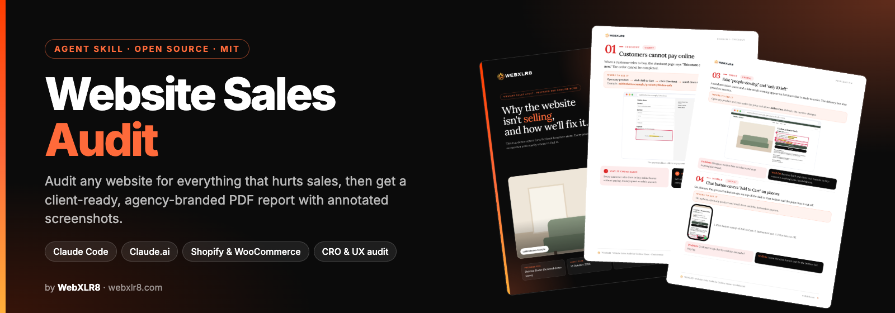
</p>

<h1 align="center">Website Sales Audit</h1>

<p align="center">
  <b>An open-source AI agent skill for Claude that audits any website for conversion, UX and e-commerce problems and turns them into a client-ready, white-label PDF report with annotated screenshots.</b>
</p>

<p align="center">
  <a href="https://github.com/webxlr8/website-sales-audit/releases"></a>
  <a href="LICENSE"></a>
  
  
  
  <a href="https://github.com/webxlr8/website-sales-audit/stargazers"></a>
</p>

<p align="center">
  <a href="examples/demo/sample-report.pdf"><b>📄 Sample PDF report</b></a> ·
  <a href="https://webxlr8.github.io/website-sales-audit/"><b>🌐 Website</b></a> ·
  <a href="#install"><b>⚡ Install</b></a> ·
  <a href="#faq"><b>❓ FAQ</b></a>
</p>

---

Give Claude a URL. It checks the whole site on **desktop and mobile**, tests the buying journey up to checkout, verifies every problem, and hands you a **branded PDF website audit report**. Every problem comes with an annotated screenshot, the exact clicks to see it, why it costs sales and what you'll fix.

It's built for **web agencies, freelancers, CRO consultants and Shopify experts** who need to win clients with a professional audit, and for **store owners** who want to know why visitors don't buy.

## Contents
- [What you get](#what-you-get)
- [What it checks](#what-it-checks)
- [How it works](#how-it-works)
- [Install](#install)
- [Set up your agency branding](#set-up-your-agency-branding-white-label)
- [Usage](#usage)
- [Screenshots](#screenshots)
- [FAQ](#faq)
- [Contributing](#contributing)

## What you get

| | |
|---|---|
| 📸 **Annotated screenshots** | Numbered red boxes and highlighted text show exactly what's wrong, on desktop (1440px) and mobile (iPhone). |
| 🧭 **"Where to see it"** | Click paths and links for every problem, so the client can reproduce it in 30 seconds. |
| 🏷️ **White-label PDF** | Your agency's logo, colours and contacts. The client's own font and logo. A4 and print-ready. |
| ✅ **Verified findings** | Each issue is re-checked at full resolution and measured before it goes in, so no embarrassing false claims. |
| 🗣️ **Plain language** | Written for business owners: what's wrong, why it costs sales, what you'll do. No jargon, no free how-to guide. |
| 🗓️ **30-day plan + "Why us"** | The report ends with a fix plan and a page that sells your agency. |

## What it checks

A **conversion rate optimization (CRO) and UX audit checklist** built from real e-commerce audits:

- **Checkout and payments**: stores that can't take payments, missing payment methods, broken carts, and on Shopify, missing policy pages.
- **Theme template leftovers**: demo text such as "clothing items", "$150 free shipping", "Lorem ipsum" or "Your content" left on live product pages.
- **Dark patterns and trust**: fake "people viewing" counters, fake low-stock warnings, permanent fake discounts, missing reviews, empty testimonial pages.
- **Mobile UX bugs**: chat or WhatsApp buttons covering *Add to Cart*, cut-off prices, oversized hero banners, horizontal scroll.
- **Broken features**: wishlist 404s, quick-view popups cut off, blog articles that don't open, order tracking that doesn't track.
- **Contradictions and typos**: delivery times that differ between pages, multiple phone numbers, misspelt product names.
- **Findability and measurement**: page titles, meta descriptions, H1s, page speed (LCP), analytics and pixel tags.

Works with **Shopify, WooCommerce, WordPress, Wix, Squarespace, Webflow** and custom sites. Shopify stores get extra catalogue analysis from the product feed.

## How it works

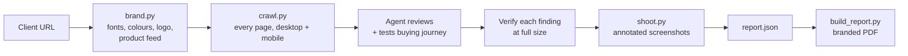

The agent follows [`SKILL.md`](SKILL.md). The Python scripts do the deterministic work: brand extraction, crawling, screenshots and the PDF build. The agent does the judgement: what's actually broken, what matters for sales, and how to explain it simply.

## Install

### Claude Code
```bash
git clone https://github.com/webxlr8/website-sales-audit ~/.claude/skills/website-sales-audit
pip install playwright pillow pypdfium2
python3 -m playwright install chromium   # skip if Google Chrome is installed
```

### Claude.ai / Claude desktop app
Download this repo as a ZIP and upload it under **Settings → Capabilities → Skills**. Code execution must be enabled.

### Other AI agents
Any agent that supports the open `SKILL.md` format can load the folder. The scripts are plain Python 3 and work on their own too.

## Set up your agency branding (white-label)

```bash
mkdir -p ~/.config/website-sales-audit
cp ~/.claude/skills/website-sales-audit/assets/agency.example.json ~/.config/website-sales-audit/agency.json
```

Edit `agency.json` with your name, website, email, phone, city, accent colour, logos (for light and dark backgrounds), credibility stats and optional client logos. [`examples/agency-webxlr8/`](examples/agency-webxlr8/) is a complete example. If you skip this step, Claude asks for the details on your first audit. The full schema is in [`references/report-json.md`](references/report-json.md#agency-config-configwebsite-sales-auditagencyjson).

## Usage

Ask in plain words:

> Audit https://example-store.com and make a client report showing everything that's hurting sales.

> Find all the UX issues on this Shopify store with screenshots so I can pitch the owner: example.com

> Do a website audit for my prospect example.com and give me the PDF.

Or run the scripts yourself:

```bash
S=~/.claude/skills/website-sales-audit/scripts
python3 $S/brand.py  https://example.com ./example-audit                  # brand + product feed
python3 $S/crawl.py  https://example.com ./example-audit                  # desktop + mobile screenshots
python3 $S/shoot.py  ./example-audit ./example-audit/shots.json           # annotated evidence
python3 $S/build_report.py ./example-audit                                # report.json -> PDF
```

Rebuild the sample report:
```bash
python3 scripts/build_report.py examples/demo --agency examples/agency-webxlr8/agency.json
```

## Screenshots

Pages from the [sample report](examples/demo/sample-report.pdf) for **Oakline Home**, a fictional furniture store:

| Cover | One-page summary | Urgent problem |
|---|---|---|
| 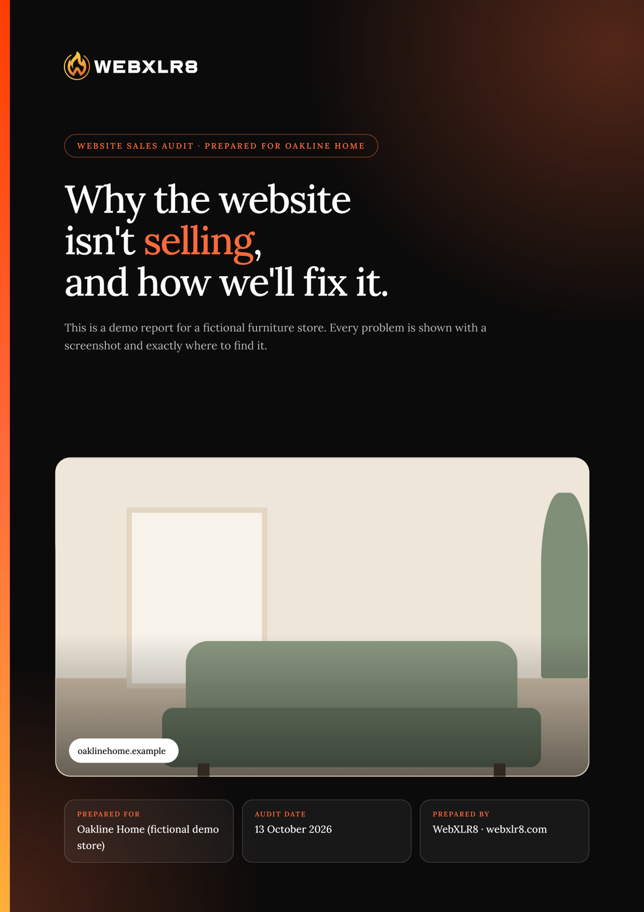 | 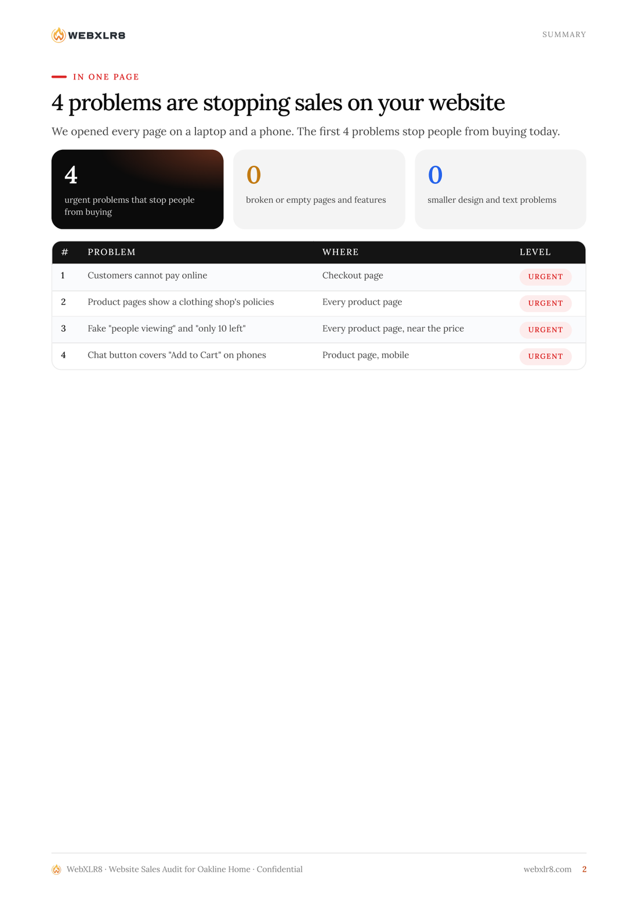 | 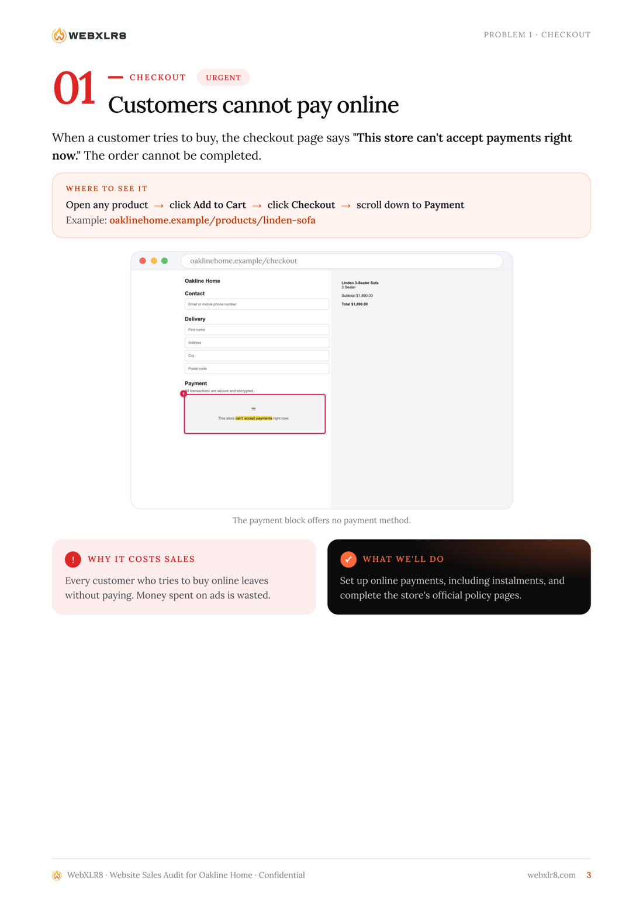 |
| **Template text found** | **Two problems per page** | **Growth ideas** |
| 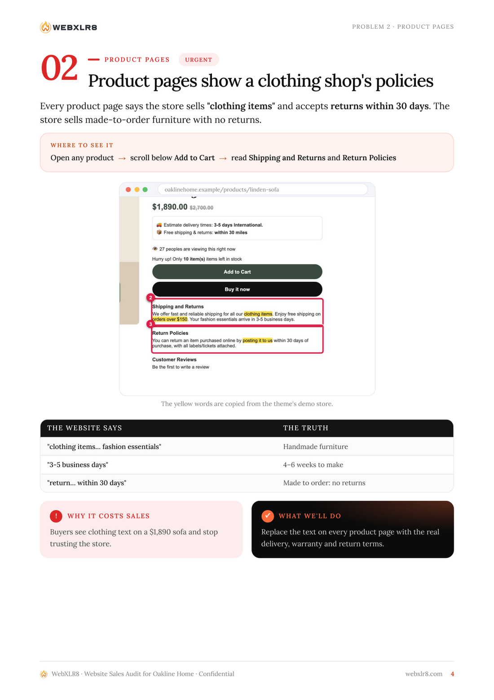 | 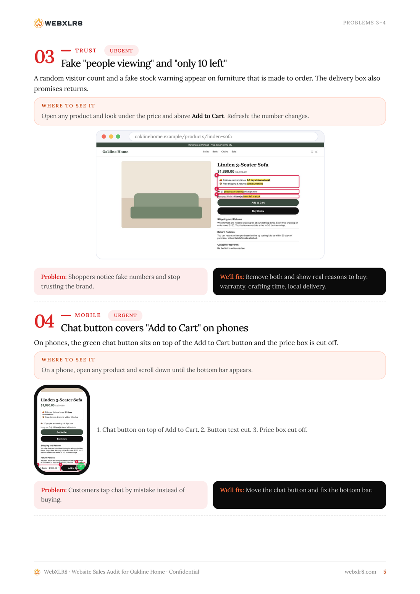 | 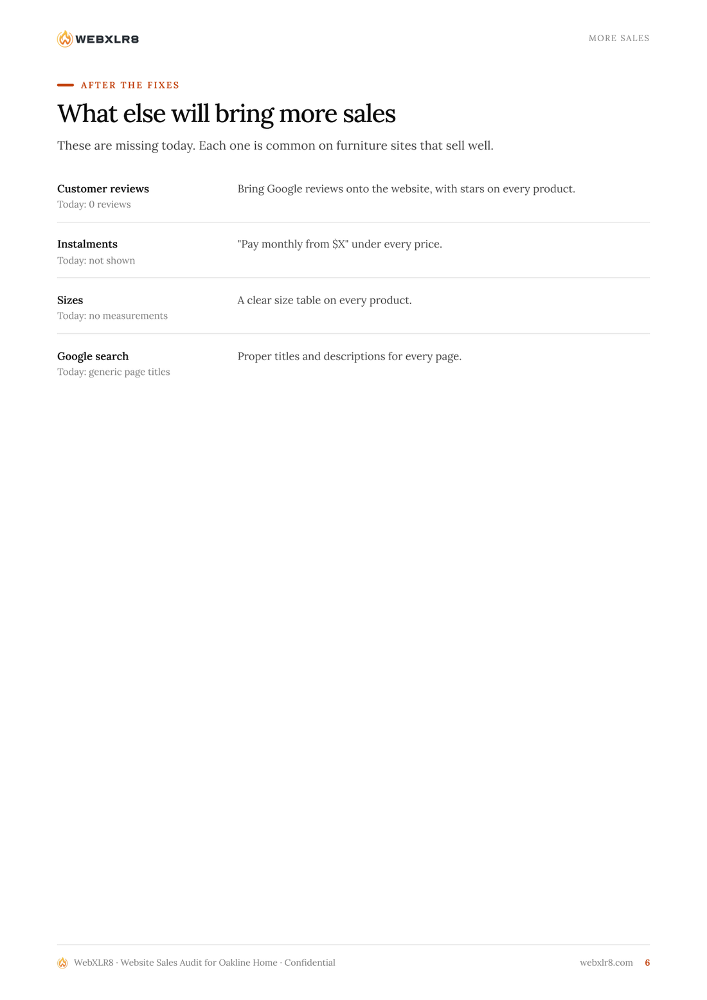 |
| **30-day plan** | **Why us** | **Back cover** |
| 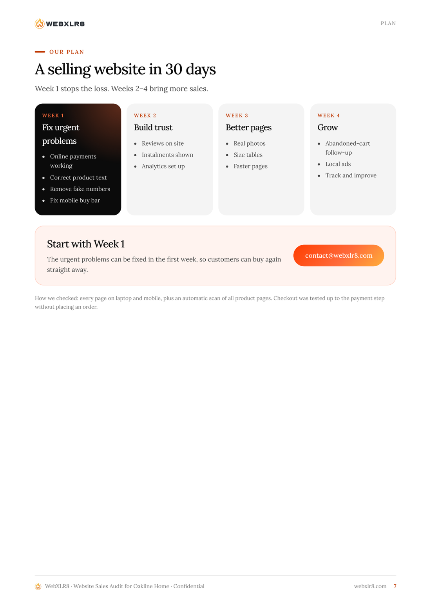 | 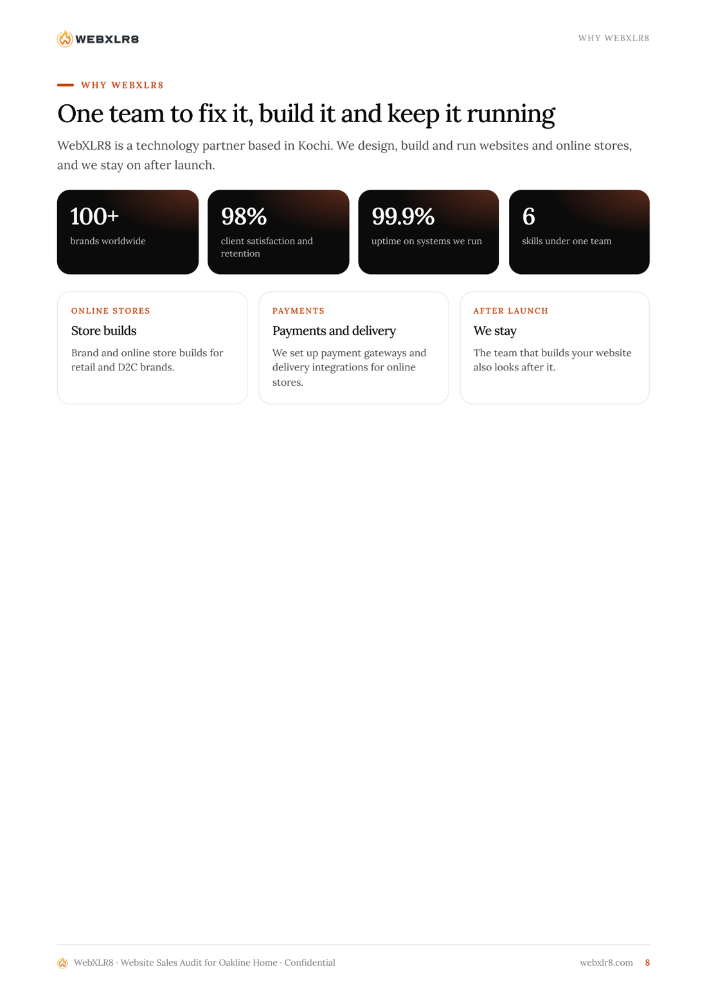 | 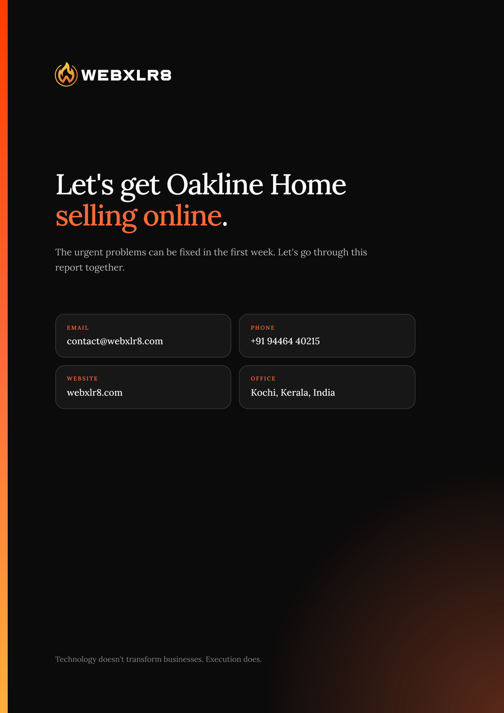 |

## FAQ

**Is it free?**
Yes. It's MIT-licensed and you can use it for client work, including paid audits.

**Which AI does it need?**
It's written as a Claude Agent Skill (Claude Code, Claude.ai, Claude desktop). The scripts are standard Python and Playwright, so other agents can follow `SKILL.md` too.

**Does it place orders or fill in forms?**
No. Checkout is tested only up to the payment step. It never enters personal or payment details or submits forms.

**Can I put my own agency's logo and colours on the report?**
Yes. It's fully white-label: set `~/.config/website-sales-audit/agency.json` once.

**Does it work for non-Shopify sites?**
Yes. Any public website works. Shopify gets extra product-catalogue checks.

**Is it an SEO audit tool?**
It's a sales and conversion audit. It covers SEO basics (titles, meta descriptions, H1s, speed, tracking) but focuses on what stops visitors from buying.

**What languages and countries does it support?**
Reports are in English by default. The agent adapts currency, payment options and consumer-law references to the client's market.

## Using it responsibly
- Audit public pages only, the way any visitor sees them. The crawler loads each page once per device, with pauses between pages.
- Treat reports as confidential sales documents for the site owner. Don't publish another business's audit without permission.
- Only show client logos you have permission to use.

## Contributing
Issues and pull requests are welcome, especially new checks for [`references/checklist.md`](references/checklist.md), support for more platforms and translated report text. Please use the fictional demo store, not real client data, in pull requests.

## License
[MIT](LICENSE) © 2026 [WebXLR8](https://webxlr8.com). Built by WebXLR8, a web and commerce engineering team in Kochi, India.

<sub>Keywords: website audit, AI website audit, conversion rate optimization, CRO audit, UX audit, e-commerce audit, Shopify audit, WooCommerce audit, website audit report template, white-label audit report, agency pitch, Claude skill, Claude Code skill, AI agent skill, Playwright.</sub>
